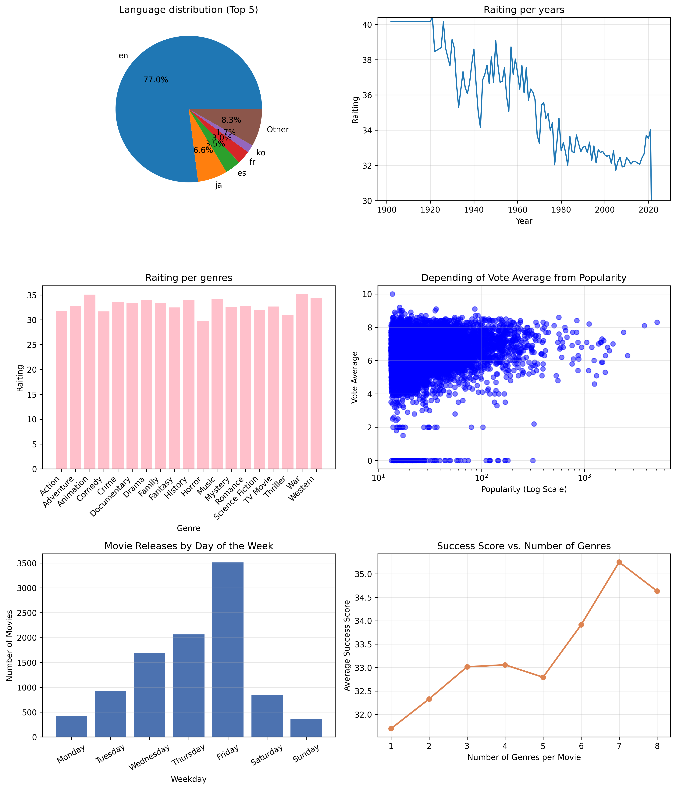

# Netflix Movies Data Analysis

An exploratory data analysis (EDA) project examining trends, language distribution, genre performance, and audience reception across a dataset of Netflix movies.

netflix_analysis.ipynb

---

## Project Overview

This project analyzes a movie metadata dataset (`mymoviedb`) to uncover patterns in movie popularity, viewer ratings, release timelines, and genre distribution. A custom **Success Score** metric is engineered to evaluate overall movie performance by combining normalized popularity and average vote ratings.

### Dataset
* **Source:** [Netflix Movies and TV Shows Data Analysis (Kaggle)](https://kaggle.com)
* **Features analyzed:** Release Date, Title, Overview, Popularity, Vote Count, Vote Average, Original Language, and Genre.

---

## Dashboard Preview



---

## Key Insights

* **English Dominance & Asian Content Presence:** English (`en`) accounts for **77.0%** of all titles in the dataset. Among non-English releases, Japanese (`ja`, **6.6%**) and Korean (`ko`, **1.7%**) stand out alongside Spanish (`es`, **3.5%**) and French (`fr`, **3.0%**), reflecting strong representation of anime and Asian cinema.
* **Historical Rating Trends:** Average `Success_Score` was noticeably higher for older/classic releases (averaging ~37–40 between 1920 and 1960) and gradually stabilized around **32–33** from the 1980s onward as catalog volume expanded.
* **Consistent Performance Across Genres:** Average `Success_Score` remains relatively balanced across genres (mostly clustering between **32 and 35**), with **Animation**, **War**, and **Western** leading slightly (~34.5–35), while **Horror** scores the lowest (~29.8).
* **Popularity vs. Rating:** Most titles cluster between a `Vote_Average` of **5.0 and 8.0** regardless of popularity. However, ultra-popular titles (`Popularity > 1,000`) rarely receive poor ratings—nearly all maintain a score above **6.0**, indicating that mainstream hits generally achieve broad audience approval.

---

## Methodology & Feature Engineering

1. **Data Cleaning & Preprocessing:**
   * Converted `Popularity`, `Vote_Count`, and `Vote_Average` to numeric formats and filtered out unrated titles (`Vote_Count == 0`).
   * Parsed `Release_Date` into granular temporal features (`Year`, `Month`, `Day`, `Weekday`, `Quarter`, and `Year_Month`).
2. **Feature Engineering:**
   * **`Success_Score`:** A composite 0–100 metric weighting normalized `Popularity` (50%) and `Vote_Average` (50%).
   * **Engagement & Popularity Tiers:** Categorized titles based on `Vote_Count` (`Low` to `Very High`) and `Popularity` bins.
   * **Genre & Language Grouping:** Extracted primary genres (`Main_Genre`), counted multi-genre tags (`Genre_Count`), and grouped low-frequency languages into an `Other` category.

---

## Technologies Used

* **Python 3**
* **Pandas** — data cleaning, transformation, grouping, and feature engineering
* **Matplotlib** — multi-panel exploratory data visualization
* **Google Colab** — development environment

---

## How to Run

1. **Google Colab:** Click the **Open in Colab** badge at the top of this file to run the notebook directly in your browser.
2. **Locally:**
   ```bash
   git clone https://github.com
   cd NetflixMoviesDataset
   pip install pandas matplotlib
   ```
   Open the `.ipynb` notebook in Jupyter or VS Code and run all cells.

---

## Project Structure

```text
├── netflix-movies-analysis.ipynb        # Main Google Colab / Jupyter notebook with code and plots
├── dashboard.png                        # Exported 3x2 visualization summary
├── netflix_titles.csv                   # Dataset file
└── README.md                            # Project documentation
